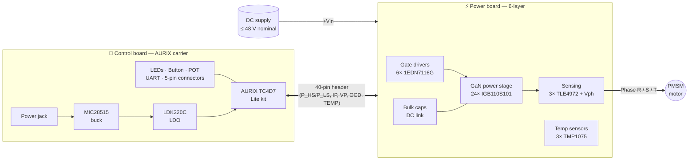
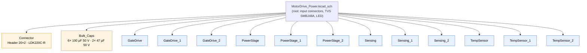
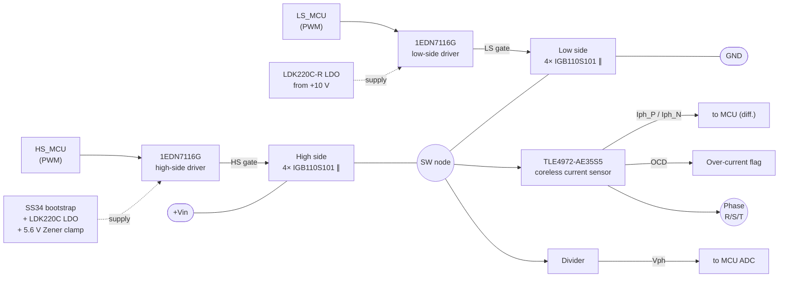
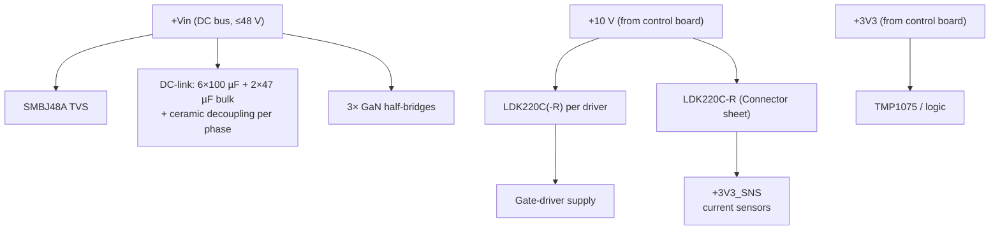
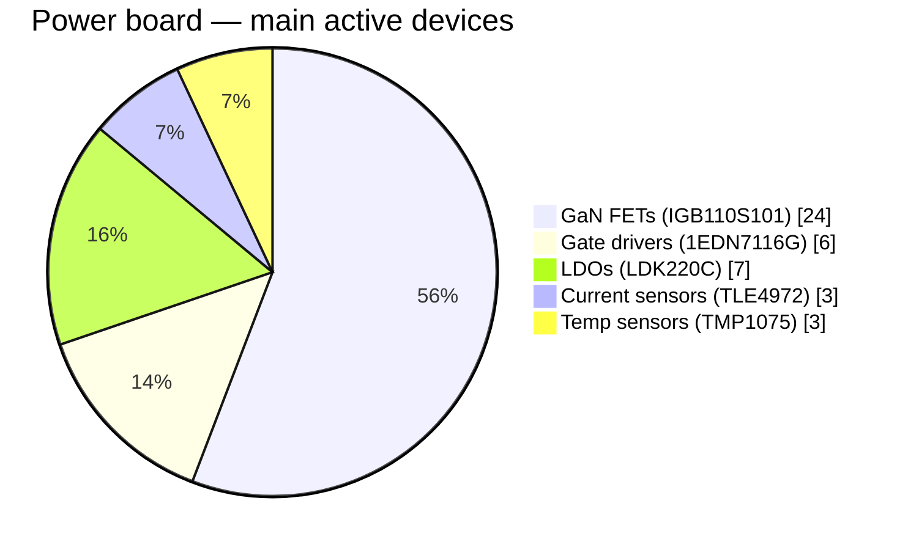
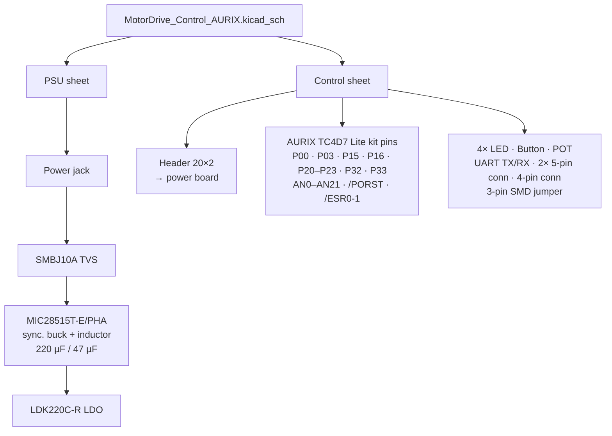
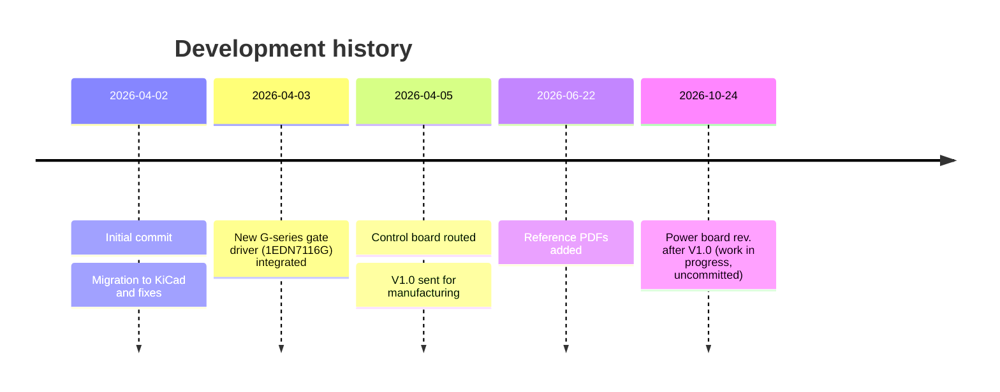
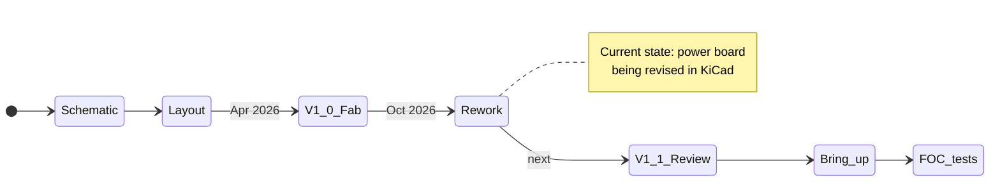

# GaN FET PMSM Motor Control Test Bench — PCB Hardware

A two-board, 3-phase **GaN-based inverter** for driving a **PMSM / BLDC motor** with Field-Oriented Control (FOC).
The design takes inspiration from Infineon's CoolGaN™ motor-drive evaluation boards (EVAL-MTR-48V150A-GaN), whose user manuals are kept in this folder for reference.

| Board | KiCad project | Purpose |
|---|---|---|
| **Power board** | [`KicadPower/MotorDrive_Power`](KicadPower/MotorDrive_Power.kicad_pro) | 3-phase GaN half-bridges, gate drivers, current / voltage / temperature sensing, DC-link capacitors |
| **Control board** | [`KicadControlAURIX/MotorDrive_Control_AURIX`](KicadControlAURIX/MotorDrive_Control_AURIX.kicad_pro) | Carrier for the Infineon **AURIX™ TC4D7 Lite kit (A3G)**, logic supply, user I/O, 40-pin link to the power board |

---

## 1. System overview



---

## 2. Power board

### 2.1 Schematic hierarchy

The root sheet `MotorDrive_Power.kicad_sch` reuses one sheet per function and instantiates it **three times — once per phase**.



### 2.2 One phase leg

Each phase is a half-bridge with **4 paralleled GaN HEMTs on the high side and 4 on the low side** (8 × IGB110S101 per phase, 24 in total). Each switch group has its own single-channel gate driver.



> The PowerStage sheet also carries a note for the alternative part **IGB070S10S1**.

### 2.3 Power tree



### 2.4 Signals on the 40-pin board-to-board header

| Signal | Count | Direction (power board) | Description |
|---|---|---|---|
| `P_HS[1..3]` | 3 | in | High-side PWM per phase |
| `P_LS[1..3]` | 3 | in | Low-side PWM per phase |
| `IP_P[1..3]`, `IP_N[1..3]` | 6 | out | Differential phase-current outputs (TLE4972) |
| `VP[1..3]` | 3 | out | Phase-voltage sense |
| `OCD` | 1 | bidir | Wired over-current detect from current sensors |
| `TEMP{…}` | bus | passive | I²C bus to the three TMP1075 sensors (A0–A2 address straps) |
| `+Vin`, `+10V`, `+3V3`, `GND` | — | power | Supply rails |

Dedicated KiCad net classes exist for `P_HS`, `P_LS`, `IP_P`, `IP_N`, `VP` (with a 100 Ω tuning profile for the current-sense pairs).

### 2.5 Key components

| Function | Part | Qty |
|---|---|---|
| GaN HEMT, 100 V | Infineon **IGB110S101** (PG-VSON-4) | 24 |
| Gate driver | Infineon **1EDN7116GXTMA1** | 6 |
| Current sensor | Infineon **TLE4972-AE35S5** (coreless, with OCD) | 3 |
| Temperature sensor | TI **TMP1075DGKR** (I²C) | 3 |
| LDO | ST **LDK220C / LDK220C-R** | 7 |
| Bootstrap diode | SS34 | 3 per phase |
| Input TVS | SMBJ48A | 1 |
| Bulk capacitors | 100 µF 50 V / 47 µF 50 V | 6 / 2 |



### 2.6 PCB

| Parameter | Value |
|---|---|
| Size | **91 × 71 mm** |
| Copper layers | **6** (F.Cu, In1–In4, B.Cu) |
| Board thickness | ≈ 1.56 mm |
| Footprints | 343 |
| Vias / track segments / zones | 1476 / 1064 / 35 |
| Default rules | 0.2 mm track, 0.1 mm clearance, 0.6/0.3 mm via |

```text
   ┌──────────────── 6-layer stack ────────────────┐
   │ F.Cu   ▓▓▓▓▓▓▓▓▓▓▓▓▓▓▓▓▓▓▓▓▓▓▓▓▓▓▓▓▓▓▓▓▓▓▓▓▓▓ │  GaN FETs, drivers, power copper
   │ In1.Cu ░░░░░░░░░░░░░░░░░░░░░░░░░░░░░░░░░░░░░░ │
   │ In2.Cu ░░░░░░░░░░░░░░░░░░░░░░░░░░░░░░░░░░░░░░ │  inner planes / power-loop return
   │ In3.Cu ░░░░░░░░░░░░░░░░░░░░░░░░░░░░░░░░░░░░░░ │
   │ In4.Cu ░░░░░░░░░░░░░░░░░░░░░░░░░░░░░░░░░░░░░░ │
   │ B.Cu   ▓▓▓▓▓▓▓▓▓▓▓▓▓▓▓▓▓▓▓▓▓▓▓▓▓▓▓▓▓▓▓▓▓▓▓▓▓▓ │
   └────────────────────── ≈1.56 mm ───────────────┘
```

---

## 3. Control board (AURIX carrier)



| Parameter | Value |
|---|---|
| Size | **145.9 × 100 mm** |
| Copper layers | 2 |
| Board thickness | ≈ 1.69 mm |
| Footprints | 114 |
| Vias / track segments / zones | 431 / 720 / 7 |

---

## 4. Repository layout

```text
MotorControl_TB_PCB/
├── README.md
├── KicadPower/                    # Power board (KiCad)
│   ├── MotorDrive_Power.kicad_pro/.kicad_sch/.kicad_pcb/.kicad_dru
│   ├── PowerStage.kicad_sch       # 8× GaN per phase
│   ├── GateDrive.kicad_sch        # 2× 1EDN7116G per phase
│   ├── Sensing.kicad_sch          # TLE4972 + phase voltage
│   ├── TempSensor.kicad_sch       # TMP1075
│   ├── Bulk_Caps.kicad_sch
│   ├── Connector.kicad_sch        # 40-pin link to control board
│   ├── MotorDrive_Power.csv       # early BOM export
│   └── Lib/                       # 1EDN7116GXTMA1 symbol + footprint
├── KicadControlAURIX/             # Control board (KiCad)
│   ├── MotorDrive_Control_AURIX.*
│   ├── PSU.kicad_sch / Control.kicad_sch
│   └── AURIX A3G TC4D7 Lite kit user guide (PDF)
├── Tags/                          # Released packages: Power_V1.0.zip, control_V1.0.zip
└── Infineon CoolGaN eval-board user manuals (PDF)
```

---

## 5. Project timeline & current status





### Status checklist

- [x] Power-board schematic (3-phase, hierarchical)
- [x] Control-board schematic (AURIX carrier + PSU)
- [x] Both PCBs laid out
- [x] **V1.0** released to manufacturing — packages in [`Tags/`](Tags)
- [ ] **Power-board revision after V1.0 (in progress, uncommitted)**
  - Sensing: 3-pin SMD jumper + 2-pin header replaced by a `Conn_01x03` with 10 Ω / 4.7 kΩ
  - GateDrive: bootstrap diodes moved to an `SS34` library symbol (3 per phase)
  - Connector / TempSensor sheets updated, PCB re-routed, net classes added
- [ ] Commit and tag the revised power board
- [ ] Board bring-up: supplies, gate drive, sensor calibration
- [ ] FOC firmware on the AURIX and motor tests

---

## 6. Tools & references

- **KiCad** (projects migrated from Altium; most parts come from the `RezaLIB` library)
- Infineon *EVAL-MTR-48V150A-GaN* user manual
- Infineon *FOC motor-drive evaluation board based on CoolGaN™ transistors* user manual
- Infineon *KIT_A3G_TC4D7_LITE* user guide (in `KicadControlAURIX/`)
